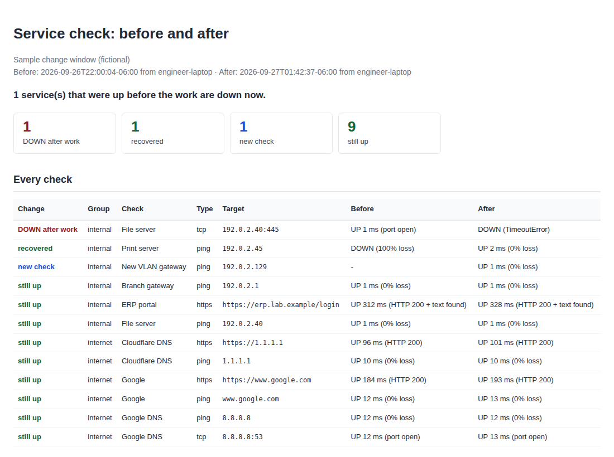

# Checklist: HTTPS and Ping Before/After

[](https://github.com/wramirezsa/checklist_https_and_ping_requests-/actions/workflows/ci.yml)


Run it before a change window, run it again after, and it tells you which
services stopped answering. Every target can be checked by ping, by HTTP(S)
request, and by TCP port; the second run is compared with the first and the
report puts anything that went down at the top.



---

## Why this exists

"Is everything still working?" is the question at the end of every
maintenance window, and it is usually answered by someone opening a few pages
from memory. The problem is the service nobody thought to check, which turns
up on Monday morning as a ticket. Recording what was reachable *before* the
work, from the same machine, turns the question into a diff:

- **DOWN after work**: it answered before and does not now. Fix before closing the window.
- **Down before and after**: it was already broken; not caused by this change, and now documented.
- **Recovered**: the change fixed something.
- **Still up**: nothing to do.

---

## Install

```bash
git clone https://github.com/wramirezsa/checklist_https_and_ping_requests-.git
cd checklist_https_and_ping_requests-
pip install -e .
```

Python 3.9+, one dependency (PyYAML). Ping uses the operating system's `ping`,
so it works on Windows, macOS and Linux without administrator rights.

---

## Use it

**1. List what matters.** Copy the example and add your services:

```bash
cp targets.example.yml targets.yml
```

```yaml
groups:
  internet:
    - name: Google
      host: www.google.com
      ping: true
      url: https://www.google.com
    - name: Google DNS
      host: 8.8.8.8
      ping: true
      tcp: [53]
    - name: Cloudflare DNS
      host: 1.1.1.1
      ping: true
      url: https://1.1.1.1

  internal:
    - name: YOUR_APP_NAME
      host: YOUR_APP_HOST
      url: https://YOUR_APP_URL/login
      expect: [200]
      contains: "Sign in"
      insecure: true            # internal app with a self-signed certificate
    - name: YOUR_FILE_SERVER
      host: YOUR_SERVER_IP
      ping: true
      tcp: [445, 3389]
```

`targets.yml` is in `.gitignore`, so client hostnames never end up in a commit.

**2. Before the work:**

```bash
python -m svccheck run --label before
```

**3. After the work,** compared against the first run:

```bash
python -m svccheck run --label after --compare snapshots/20260926-220004-before.json
```

```
CHANGE                 CHECK                    TYPE   TARGET
DOWN after work        File server              tcp    192.0.2.40:445
recovered              Print server             ping   192.0.2.45
new check              New VLAN gateway         ping   192.0.2.129
still up               Branch gateway           ping   192.0.2.1
still up               ERP portal               https  https://erp.lab.example/login
...
1 regression(s) out of 12 checks
```

The exit code is `1` when anything went down, so it can gate a script or a
pipeline. Two saved snapshots can also be compared later with
`python -m svccheck compare BEFORE.json AFTER.json`.

**Try it offline** with the bundled sample (a fictional change window):

```bash
python -m svccheck demo
```

---

## What each check records

| Type | Up when | Also records |
|---|---|---|
| `ping` | at least one reply | loss %, average round trip |
| `https` | the status code is in `expect` (default 200, 30x, 401, 403) and `contains` is found, if set | status, response time, final URL, days until the TLS certificate expires |
| `tcp` | the port accepts a connection | connect time |

A 401 or 403 counts as up by default: the service answered, it just wants a
login. Set `expect: [200]` when you need the page itself.

Snapshots are plain JSON in `snapshots/`, named by date and label, and include
the machine they were taken from. Run the before and after checks from the same
place, or the comparison is measuring two different paths.

---

## Layout

```
svccheck/
  probes.py   ping, HTTPS and TCP checks
  runner.py   targets, parallel execution, snapshots, comparison
  report.py   console tables and the HTML report
  cli.py      run, compare, demo
examples/snapshots/   a fictional before/after pair
targets.example.yml
```

## Notes

- Requests go through the system proxy if `HTTPS_PROXY` is set.
- Checks run in parallel (16 at a time), so a list of a hundred targets takes seconds.
- Nothing is sent to any service other than the ones in your list.

## License

MIT
